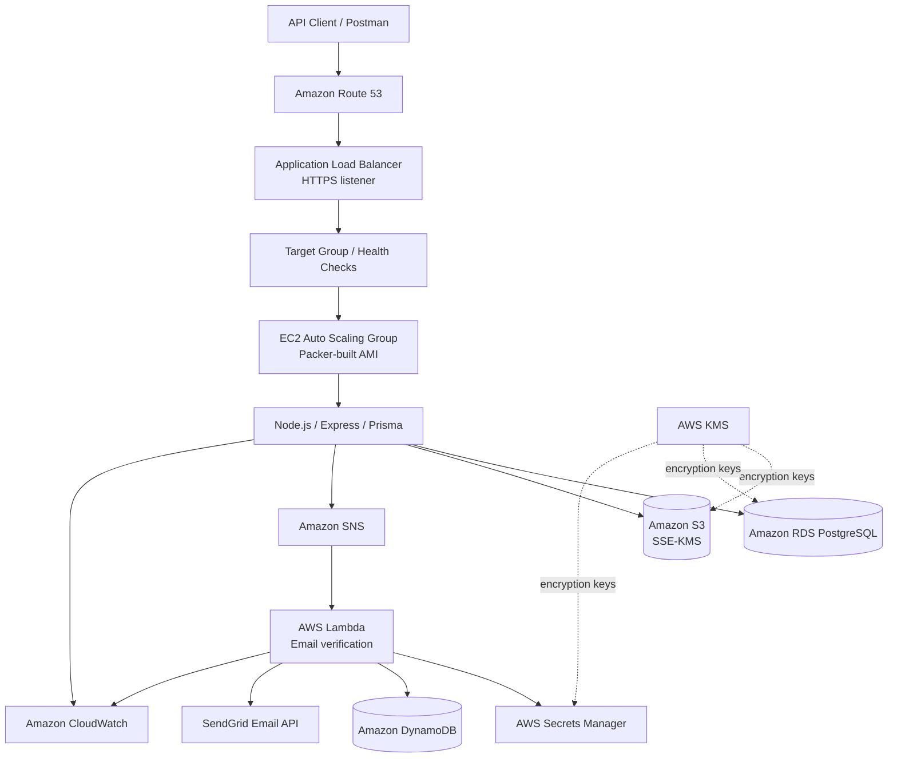
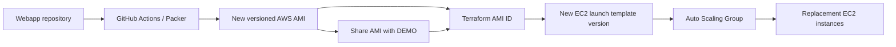

# Cloud-Native Course Management Platform

**CSYE 6225 — Cloud Computing | AWS, GCP, Terraform, Packer, and GitHub Actions**

## Project overview

This project implements a cloud-hosted REST API for account management and academic course resources. Users can register, verify their email addresses, create course records, and attach syllabus files to courses. The application combines a Node.js/Express API with a PostgreSQL database, Amazon S3 object storage, and an event-driven email verification service.

The infrastructure is defined as code using Terraform. Packer creates reusable application machine images, while GitHub Actions provides automation for image builds and Lambda code deployment. The architecture is designed to separate application artifacts from environment-specific infrastructure and to support distinct development and demonstration AWS accounts.

## Application capabilities

| Capability | Implementation |
| --- | --- |
| Health monitoring | `GET /healthz` performs a database-backed health check using Prisma and returns HTTP 200 when the database write succeeds. |
| Account registration | User data is stored in PostgreSQL; registration initiates an email verification event. |
| Email verification | The API publishes a message to SNS; a subscribed Lambda function uses SendGrid to email a verification link. |
| Course management | Course records, including department, course number, credits, and descriptive information, are persisted in PostgreSQL. |
| Syllabus management | Syllabus objects are uploaded to an encrypted S3 bucket, with metadata linked to courses in PostgreSQL. |
| Email delivery tracking | DynamoDB records processed verification messages to avoid repeat sends for the same email/token pair. |

## Architecture

### Request flow

**Synchronous API requests.** Route 53 resolves the application hostname to an internet-facing Application Load Balancer (ALB). HTTPS traffic is forwarded to a target group containing EC2 instances managed by an Auto Scaling Group. Each instance runs the Express API under a systemd service. Prisma handles persistence to PostgreSQL on RDS.

**Email verification.** The API publishes an SNS message containing the recipient, first name, and verification token. SNS invokes the Lambda function, which reads SendGrid configuration from Secrets Manager, checks a DynamoDB message key for prior delivery, sends the verification link, and records successful processing. The verification link points back to the application's validation endpoint.

**Syllabus upload.** The API uploads the file to S3 using the EC2 instance role. The S3 bucket uses a customer-managed KMS key, so the instance role requires both S3 object permissions and the relevant KMS cryptographic permissions. Syllabus metadata is stored in the relational database.

## Technology stack

| Layer | Technologies |
| --- | --- |
| API | Node.js 20, Express 5, JavaScript (CommonJS) |
| Database access | Prisma ORM and Prisma migrations |
| Relational storage | PostgreSQL on Amazon RDS |
| Object storage | Amazon S3 |
| Event processing | Amazon SNS, AWS Lambda |
| Delivery and tracking | SendGrid, Amazon DynamoDB |
| Infrastructure | Terraform, AWS IAM, VPC, subnets, security groups, ALB, Auto Scaling, Route 53 |
| Encryption and secrets | AWS KMS, AWS Secrets Manager, SSE-KMS |
| Images | HashiCorp Packer, Ubuntu 24.04 AMI, Google Compute Engine image |
| Observability | Amazon CloudWatch logs and custom application metrics via StatsD |
| Automation | GitHub Actions, npm, AWS CLI |
| Validation | Postman and AWS Console |

## Infrastructure as code with Terraform

Terraform describes the cloud resources and their relationships rather than relying on manually created infrastructure. The configuration provisions networking, load balancing, compute, IAM roles, database services, encrypted storage, secrets, messaging, and serverless resources. Outputs expose identifiers such as the ALB hostname, application domain, ASG name, RDS endpoint, SNS topic ARN, Lambda function name, and secret ARNs.

The environment is selected through the **combination** of the Terraform workspace, environment-specific variable file, and AWS provider credentials/profile. A `dev.tfvars` or `demo.tfvars` filename alone does not switch AWS accounts; the provider must authenticate to the intended account, and state must be isolated correctly.

| Environment | Intended purpose |
| --- | --- |
| DEV | Development, integration testing, infrastructure changes, and initial validation. |
| DEMO | Separate demonstration/review environment with its own resources and account-specific configuration. |

The two environments can use the same Terraform definitions with different values, credentials, names, and state. Each environment's Lambda, SNS, DynamoDB, secrets, and other resources must exist before a code-only GitHub Actions deployment can update them.

**Terraform and application artifacts are separate concerns.** Terraform manages the Lambda function configuration and may initialize its code from a local ZIP path (`lambda_zip_path`) when applied locally. GitHub Actions can later update the code of an existing Lambda function without reading that local path. If both mechanisms manage the same Lambda code, the deployment process must avoid unintentionally reverting the deployed package during a later Terraform apply.

## Immutable images with Packer

Packer builds reusable application images rather than installing the entire application manually on each EC2 instance.

### AWS AMI

The AWS image uses an Ubuntu 24.04 base AMI. The Packer configuration creates an EC2-backed AMI containing the application artifact, Node.js runtime, dependencies, Prisma client, service configuration, CloudWatch agent configuration, and the application systemd unit. The image is built in the development AWS account and shared with the designated demonstration account using the AMI sharing configuration.

### Google Cloud image

The same Packer template also defines a Google Compute Engine image based on Ubuntu 24.04. This provides a second cloud image artifact for the course's multi-cloud image-building scope. Actual deployment of a GCP application stack should not be inferred from image creation alone.

### How updated images reach EC2

A new Packer build creates a **new AMI ID**; it does not modify instances already running from an older image. Terraform supplies the chosen AMI ID to the launch template. When the launch template is updated, an Auto Scaling instance refresh or other controlled replacement process rolls out instances using the new image. Merely updating the AMI variable does not guarantee existing instances are replaced unless the ASG replacement behavior is configured or initiated.

At boot, EC2 user data configures environment-specific values such as the RDS endpoint, Secrets Manager ARN, S3 bucket, SNS topic, and AWS region. It retrieves the database secret using the instance role, prepares the environment file, applies database migrations, and starts the systemd-managed application.

## GitHub Actions and CI/CD

The project separates image building, serverless deployment, and infrastructure provisioning.

### Web application / Packer workflow

The webapp workflow is designed around the repository's pull-request merge process. After an approved PR is merged into the `upstream` branch, automation can package the web application and invoke Packer to produce new cloud images. The resulting AWS AMI can be shared with the DEMO account and its ID used in the relevant Terraform environment.

**Important distinction:** building and sharing an AMI does not automatically deploy it to an existing ASG; Terraform and instance replacement complete that process.

### Serverless Lambda workflow

The Lambda deployment workflow packages `src/`, `package.json`, `package-lock.json`, and production dependencies into a ZIP artifact, authenticates to AWS, calls `aws lambda update-function-code`, and waits for the update to complete.

The intended Git workflow uses a merged pull request into `upstream`, rather than a direct push to `main`. A merged-PR trigger must include a condition checking that the PR was actually merged. Jobs should have descriptive names, such as **Deploy Lambda Function to DEV** and **Deploy Lambda Function to DEMO**, so their outcomes are visible in the GitHub Actions interface.

DEV and DEMO deployments require their respective AWS identities and Lambda function names. These are separate code deployments; neither automatically creates the function or provisions the rest of the stack. The pipeline should only deploy to an environment after Terraform has created that environment's Lambda.

**Workflow status:** the serverless deployment workflow was prepared locally during development; successful GitHub-hosted execution for both accounts has not yet been established by the tests described here.

### Deployment responsibilities

| Component | Responsibility |
| --- | --- |
| Packer workflow | Builds versioned application images and shares the AWS AMI where configured. |
| Serverless workflow | Packages and updates Lambda function code in the selected AWS accounts. |
| Terraform | Provisions and updates environment-specific cloud infrastructure, policies, secrets, and service configuration. |
| ASG instance refresh | Replaces EC2 instances to adopt a new launch template/AMI version. |

## Security design

The architecture uses IAM roles to separate EC2 and Lambda permissions. EC2 obtains AWS permissions from its instance profile rather than hardcoded application credentials. Database and email-service credentials are stored in AWS Secrets Manager, with access restricted by IAM and encrypted using AWS KMS.

Customer-managed KMS keys are defined for EBS, RDS, S3, and Secrets Manager. S3 object uploads require `s3:PutObject` plus `kms:GenerateDataKey` for the configured SSE-KMS key. KMS permissions are explicitly granted to the application role to support encrypted syllabus uploads.

The application is accessed through Route 53 and an HTTPS ALB listener, with HTTP traffic redirected to HTTPS. The database is intended to remain in private subnets, separate from the public entry point. Bucket public-access blocking and exact network rules should be confirmed against the deployed Terraform configuration.

**Secret lifecycle:** AWS Secrets Manager ordinarily schedules secret deletion with a recovery period. A Terraform destroy followed by immediate recreation of identically named secrets can therefore encounter name conflicts. The project encountered and addressed this behavior during environment rebuilds.

## Monitoring and reliability

- **ALB health checks:** the `/healthz` endpoint performs a real database write, so a successful response validates both application responsiveness and database connectivity.
- **Auto Scaling:** the ASG manages EC2 instance count and replacements across configured Availability Zones.
- **CloudWatch:** application and Lambda logs support troubleshooting of initialization, API errors, database operations, and email processing.
- **Service recovery:** systemd manages the Node.js process and is configured to restart it after failure.
- **Delivery deduplication:** DynamoDB tracks sent email messages using a SHA-256 key derived from recipient email and verification token, with a TTL attribute for expiry.

## AWS validation and observed results

The following outcomes were validated during local deployment and AWS testing:

| Test | AWS components exercised | Observed result |
| --- | --- | --- |
| `GET /healthz` over application domain | Route 53 → ALB → EC2 → RDS | Successful response. |
| User registration | Express → Prisma → RDS, SNS publishing | User creation successful. |
| Email verification | SNS → Lambda → Secrets Manager → SendGrid; DynamoDB tracking | Verification email received and account verification worked. |
| Course creation | Express → Prisma → RDS | Course created successfully. |
| Syllabus upload | Express → S3 → KMS, relational metadata | Upload succeeded after IAM/KMS permission changes. |
| ALB configuration | Route 53, HTTPS listener, target group | DNS alias and listener routing reviewed in AWS Console. |
| Auto Scaling | Launch template, ASG, EC2 | Instances launched through the ASG; health issues were resolved during debugging. |

### Operational issues investigated

During integration, several real cloud deployment issues were identified and resolved:

1. **Secrets Manager deletion conflicts:** previously destroyed secrets remained scheduled for deletion, blocking recreation under the same names.
2. **KMS key lifecycle:** an encryption key pending deletion prevented Secrets Manager from decrypting existing secret values.
3. **Unhealthy ASG instances:** startup/user-data behavior and database readiness caused target health failures during initial deployments.
4. **Lambda packaging/configuration:** missing npm script names, artifact packaging, and required environment variables affected serverless deployment and execution.
5. **S3 SSE-KMS access:** syllabus upload initially failed because the EC2 role lacked permission to generate a data key with the S3 KMS key; updating the IAM and KMS policies resolved the issue.

These tests demonstrate the main end-to-end application path in the deployed DEV environment. **They do not by themselves establish that the same tests passed in DEMO or that GitHub Actions completed successfully.** Those should be recorded as separate verification results when available.

## Project outcome

The project demonstrates how a traditional REST API can be integrated with managed cloud infrastructure and event-driven services. Its main engineering themes are repeatable infrastructure, reusable machine images, environment separation, encrypted data handling, least-privilege service access, asynchronous processing, observability, and automated deployment workflows.

The resulting system combines an HTTPS load-balanced application tier, managed relational storage, encrypted object storage, and a serverless email-verification pipeline. The architecture supports independent evolution of infrastructure, application images, and Lambda code while maintaining distinct DEV and DEMO environments.
